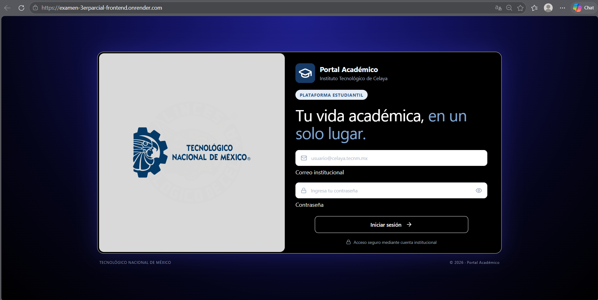
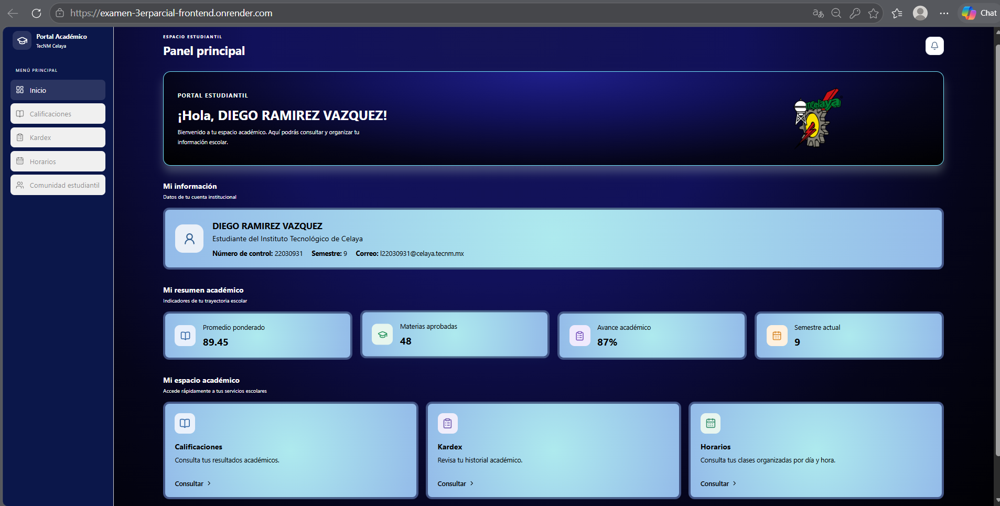
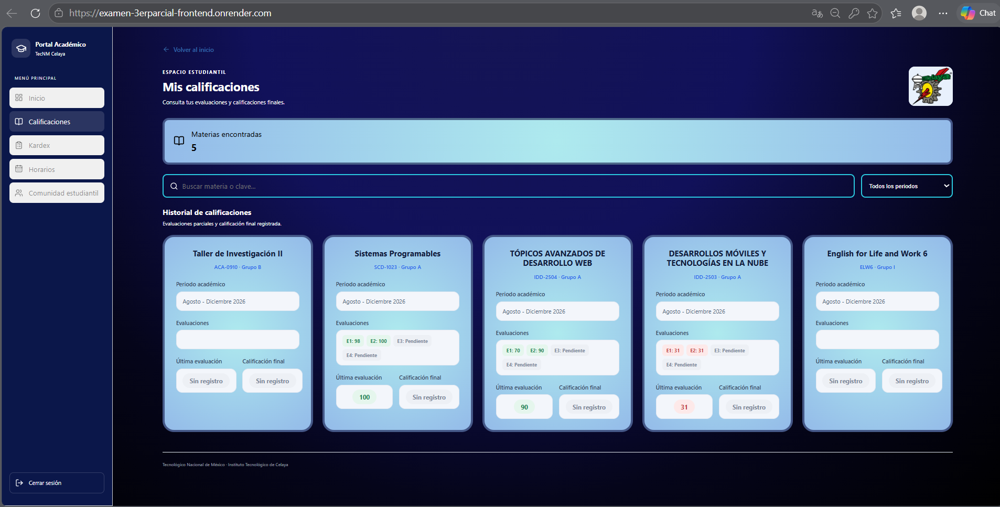
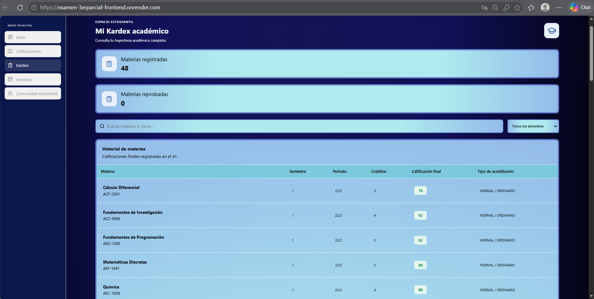
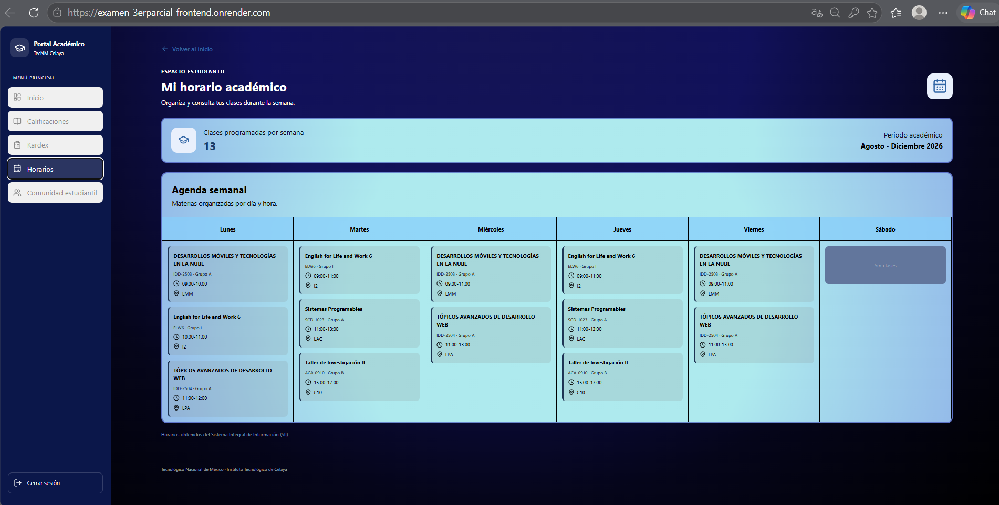
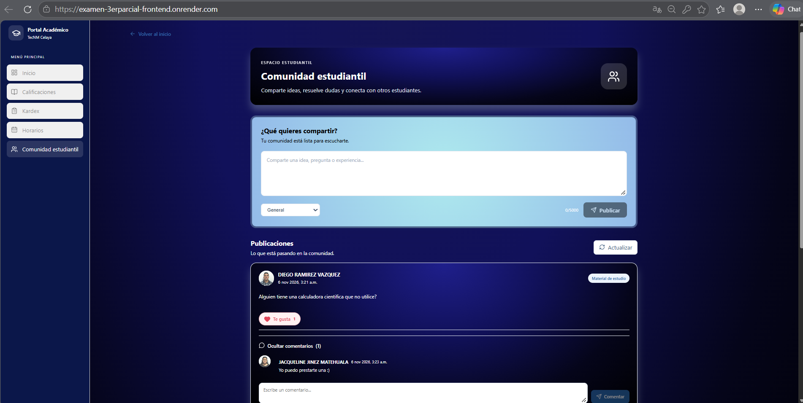

# 🎓 Sistema de Gestión Estudiantil

Aplicación web desarrollada para facilitar el acceso de los estudiantes a su información académica y ofrecer un espacio de interacción dentro de la comunidad estudiantil.

El proyecto cuenta con una arquitectura **Frontend – Backend**, bases de datos independientes para la gestión académica y la comunidad, y servicios desplegados en Render.

## Aplicación en línea

**Accede a la aplicación:**

Link para ingresar a la pagina:
https://examen-3erparcial-frontend.onrender.com

##  Documentación del proyecto

- [README del Backend](./backend/README.md)
- [README del Frontend](./frontend/README.md)

**Servicios desplegados:**

- [Frontend – Render](https://examen-3erparcial-frontend.onrender.com)
- [Backend – Render](https://examen-3erparcial-backend.onrender.com)

## 📚 Documentación del proyecto

Consulta la documentación técnica de cada componente:

| Componente | Documentación |
|---|---|
| Frontend | [README del Frontend](./frontend/README.md) |
| Backend | [README del Backend](./backend/README.md) |

## 📸 Evidencia de funcionamiento

A continuación, se muestran algunas capturas de pantalla de la aplicación en funcionamiento.

### Inicio de sesión

### Panel principal

### Panel de calificaciones

### Kardex e historial academico

### Horarios de clase

### Comunidad y foro

---

**Proyecto académico – Tercer parcial**

